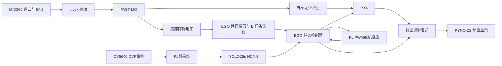

# 基于 KR260 的救援无人机系统

面向室内复杂环境的无人机系统源码。机载计算采用 AMD Kria KR260，使用 Ubuntu 22.04 与 ROS 2 Humble，结合 MID360 激光惯性定位、EGO-Planner 局部路径规划和 PX4 飞行控制；PYNQ-Z2 提供地面交互与显示。

## 源码结构

| 目录 / 包 | 功能 |
| --- | --- |
| `src/livox_ros_driver2` | MID360 点云与 IMU 驱动 |
| `src/FAST_LIO` | 激光惯性定位与规划点云输出 |
| `src/lio_px4_bridge` | 里程计到 PX4 外部定位接口的坐标、时间适配 |
| `src/ego_swarm/src/planner` | 局部地图、路径搜索、B 样条优化、轨迹消息和规划节点 |
| `src/kr260_ego_core` | 几何、体素地图、规划准入与任务状态机 |
| `src/kr260_ego_interfaces` | 地图快照与规划健康消息 |
| `src/kr260_ego_pkg` | EGO 控制节点、配置、预览入口与运行管理 |
| `src/kr260_ego_support` | 共用录包、进程归属、PX4 接口核对和地面检查 |
| `src/top_launch_pkg` | 仅定位链的分阶段启动、状态观察与日志管理 |
| `src/px4_msgs`、`quadrotor_msgs` | 飞控与规划所需消息定义 |
| `src/kr260_ground_station` | KR260 到地面站的只读遥测与规划线发送 |
| `ground_station` | PYNQ-Z2 手势、地图、仪表、HDMI 显示及配套 PL 源码 |
| `tests/ego` | 规划核心相关的纯 C++ 检查源码 |
| `vision` | OV5640 相机采集、YOLO26n NCNN 模型与识别服务 |
| `hardware/servo` | 双通道 PWM RTL、集成 PL 工程及舵机 UIO 驱动 |
| `docs/RESCUE_FLOW.md` | 识别确认、悬停、投放和 EGO 接续的接口与启动说明 |

EGO 的目标序列接口用于向规划器提交目标，每段路径由规划器结合局部地图生成。此源码包不包含原固定航点飞行程序、实飞航点坐标、原航线投放控制器或路线测量记录。地面站保留只用于显示的示例轨迹，该数据不向飞控发送任务。

## 数据链路



## 构建

目标环境为 Ubuntu 22.04 / ROS 2 Humble，需安装 ROS 开发工具、colcon、Eigen、PCL、OpenCV 和相关消息依赖。MID360 驱动另外依赖 Livox SDK2；SDK 使用系统标准安装前缀，或者通过 `LIVOX_SDK2_ROOT` 指定安装 / 源码前缀。Micro XRCE-DDS Agent 属于飞控通信的外部运行依赖。

```bash
bash build.sh
source install/setup.bash
```

构建脚本使用单任务编译，包含 EGO、定位、桥接和遥测包，不会启动飞控、雷达或任务服务。Livox 的 ROS 2 `package.xml` 已补入源码，能够由 colcon 发现。

## EGO 预览入口

```bash
source /opt/ros/humble/setup.bash
source install/setup.bash
ros2 launch kr260_ego_pkg kr260_ego.launch.py
```

此 launch 显式使用 `execute=false`，用于地图、规划和状态观察。受管理运行脚本位于 `src/kr260_ego_pkg/scripts/kr260_ego_runtime.py`，执行入口与预览入口分离，使用进程归属、录包、配置检查及已选择构建记录组织生命周期。部署时生成本机配置及构建记录，不复用他人板卡的旧收据。

`traj_utils/msg/Bspline.msg` 包含目标身份字段。规划节点、控制节点、遥测发送端和消息定义应由同一源码一起构建，避免混用不同版本生成的接口。

## 配置与隐私

视觉使用同一个 YOLO26n 权重及 NCNN 后端，包内包含 320 / 384 / 480 / 640 输入模型。任务配置为 320 输入、单推理线程，相机预览上限 3 FPS。控制器确认两张不同新画面后制动、连续停稳 5 秒、限时投放；收到 PWM 已关闭的完成反馈后，向 EGO 重新提交原目标并接续新轨迹。详见 [视觉救援流程](docs/RESCUE_FLOW.md)。

相机、舵机与 UART 的集成 PL 工程位于 `hardware/servo/vivado/`；纯相机工程保留于 `vision/camera/vivado/`。完整机载系统使用集成工程提供全部外设。

- `src/kr260_ego_pkg/config/kr260_ego.yaml` 为通用示例，场地声明默认关闭，不包含实飞路线。
- 雷达配置中的 `192.0.2.x` 是文档示例地址，实际使用时在本机填写设备网络参数。
- 地面站发送端默认指向 `127.0.0.1`，实际使用时配置地面站地址和坐标标定。
- 账号、密码、无线认证、SSH 密钥、HMAC 私钥、实飞日志、现场航点和测量文件均不随源码分发。

## 地面站

地面站源码位于 [ground_station](ground_station/README.md)，其中 `pynq_z2_desktop` 和 `pynq_z2_gesture` 保持同级，供硬件构建及共享显示服务引用。机载发送包与地面站约定只读遥测和规划线格式；地面站显示不会代替飞控闭环。

## 第三方代码

各依赖保留原始许可证和作者信息，见 [THIRD_PARTY.md](THIRD_PARTY.md)。本项目的修改不改变第三方代码原有许可。
