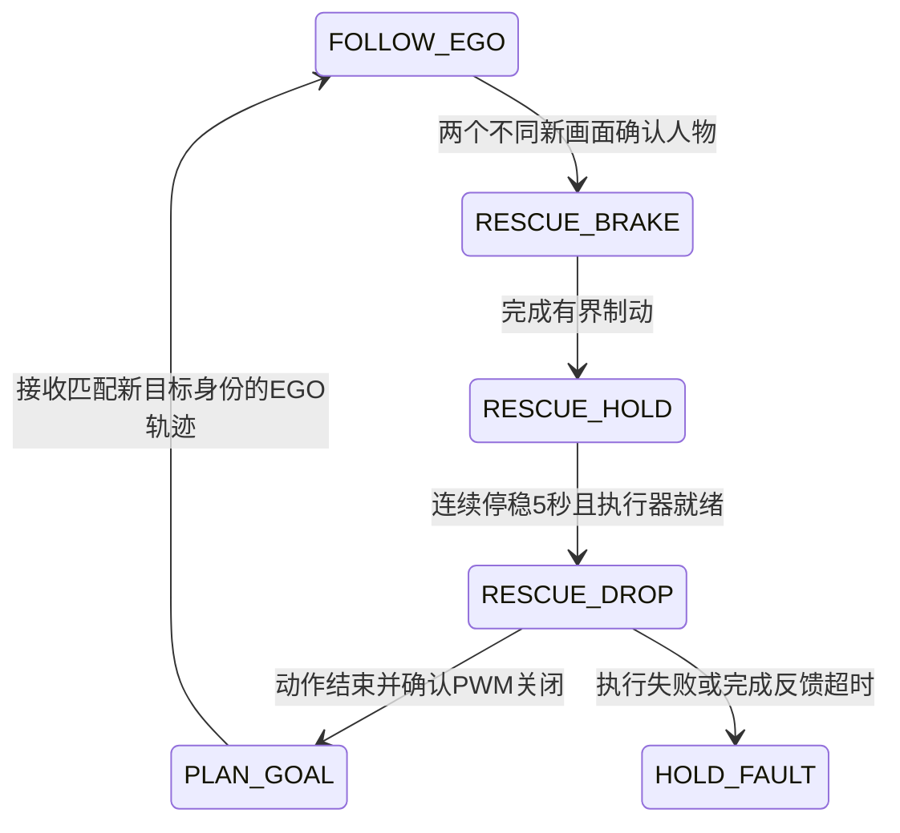

# 视觉救援与 EGO 接续

## 任务流程



救援状态机位于 `src/kr260_ego_core/include/kr260_ego_core/mission.hpp`，ROS 接口位于 `src/kr260_ego_pkg/src/kr260_ego_node.cpp`。一轮任务至多执行一次救援，避免同一张人物图片持续触发投放。每个导航目标之间仍由 EGO 根据地图规划路径。

视觉节点保留相机会话、推理会话、结果编号、硬件帧编号及原始采集时间。两次确认必须来自不同新帧；重复结果、空画面、过期画面和未来时间戳不能累积确认。时间使用同一 KR260 的单调时钟，相机的时间由 PL 帧年龄重建，HTTP 请求时间不会替换采集时间。

发现人物后沿已检查的停止走廊制动。在当前位置附近连续满足位置误差不超过 0.1 m、速度低于 0.1 m/s、航向误差不超过 5°，达到配置的 5 秒后，发送一次舵机请求。任务继续使用原有定位、地图、录包和遥控接管保护。

投放默认通道 0、1000 μs、1 秒，允许范围由舵机源码限定为 500–1700 μs。执行器通过 `servo_move.py` 操作 SRV1 外设，保留原驱动的独占锁、ABI 核对、单通道输出和退出关闭逻辑。请求的任务 ID 与动作 ID 在动作前持久记录，进程重启不会重放同一请求。投放机构的脉宽与机械开合关系应按实际装配配置。

完成反馈表示软件动作结束且寄存器确认 PWM 关闭，不表示存在机械脱落传感器。只有收到匹配本轮任务及动作编号的完成反馈，控制器才提交新的 EGO 目标时间戳，并清除旧 B 样条。恢复规划的目标仍是被中断的导航目标，原轨迹不会从过期位置继续播放。

## 消息与节点

| 话题 | 类型 | 发布者 → 使用者 |
| --- | --- | --- |
| `/kr260/rescue/person` | `PersonObservation` | `vision_status_bridge.py` → EGO 控制器 |
| `/kr260/rescue/drop_request` | `DropRequest` | EGO 控制器 → `servo_drop_executor.py` |
| `/kr260/rescue/drop_feedback` | `DropFeedback` | 舵机执行器 → EGO 控制器 |
| `/kr260/ego/status` | JSON / `std_msgs/String` | 控制器 → 执行器、地面站、录包 |

三个自定义消息位于 `src/kr260_ego_interfaces/msg/`。控制器、规划器与接口包应使用同一工作区一起编译。

执行器只接受新鲜、有效、同一任务的 `RESCUE_DROP` 状态，要求 `execute=true`、Offboard、已解锁且未落地、定位和规划健康、速度满足停稳条件。预览模式不会发送投放请求；执行器本身也不发布 PX4 控制话题。

## 组织启动

先完成本机 PL 和 UIO 配置，构建两个原生 MMIO 库，再启动相机与视觉；避免飞行过程中重载 PL。

```bash
bash hardware/servo/deploy/build_mmio.sh
bash vision/camera/deploy/build_mmio.sh
bash vision/setup_python.sh
bash vision/start_mission.sh
```

视觉服务运行在前台，画面为 `http://<板卡IP>:8081/`，按 Ctrl-C 停止推理。相机使用独立服务，可通过 `bash vision/camera/deploy/preview.sh stop` 停止。

另一终端加载本机 ROS 工作区后启动执行器；`servo_dir` 必须传绝对路径，运行用户需要对应 UIO 的读写权限。此入口不加载 PL、不发送启动复位动作，也不启动定位和飞行任务。

```bash
source /opt/ros/humble/setup.bash
source install/setup.bash
ros2 run kr260_ego_pkg servo_drop_executor.py --ros-args \
  -p servo_dir:="$(pwd)/hardware/servo/deploy"
```

受管理 EGO 运行器在启用救援时会启动视觉元数据桥接并将三个话题录入 bag。若使用独立预览 launch，可单独启动 `ros2 run kr260_ego_pkg vision_status_bridge.py`；同一时间只运行一个桥接实例。`rescue_io.launch.py` 也可启动桥接，默认不启用舵机。

EGO 预览为 `execute=false`，只检查地图、目标、规划和状态；实际任务仍由原受管理运行器完成配置、录包及地面检查。配置项位于 `config/kr260_ego.yaml`，公开示例不含现场航点。

## 软件检查

`tests/ego/test_rescue.cpp` 覆盖新帧去重、停稳等待、单次请求、错误动作编号、完成接续、执行超时、Position 接管及定位故障。`tests/ego/test_rescue_protocol.py` 覆盖源时间保留、执行授权和重启去重。舵机原驱动测试位于 `hardware/servo/tests/`。
