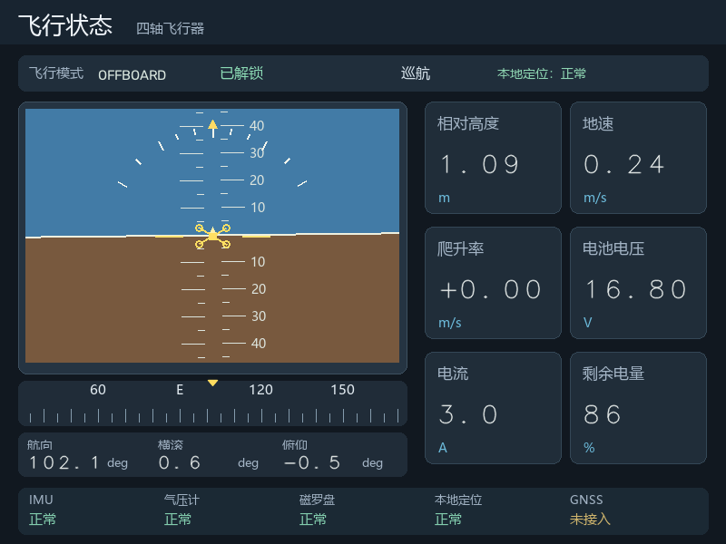

# Zynq-7020 嵌入式无人机地面站

基于 TUL PYNQ-Z2（XC7Z020-1CLG400C）的离线地面站演示系统：PL 承担 HDMI 视频输出和手势图像预处理，PS 运行 Linux/XFCE、摄像头采集、手势分类和三个页面。

本目录为地面站提交源码，保留硬件工程、软件服务和共享显示的目录关系。

## 三个页面

| 按键 | 页面 | 当前功能 |
|---|---|---|
| BTN0 | 摄像头与手势 | USB UVC 640×480 YUYV 采集，中心 ROI，拳头/张掌/剪刀及 NONE/UNKNOWN |
| BTN1 | 二维点云地图 | 12,000 个预设点、八个纸箱、两个门框、四轴图标和 60 秒折线轨迹，点云逐步显现 |
| BTN2 | 飞行状态 | 中文人工地平仪、罗盘、姿态和六个数值卡片；独立 60 秒预设数据循环 |

按当前页面的按钮返回桌面，按另一按钮直接切换；40 ms 消抖，长按只触发一次。BTN3 保留。SW0/SW1 已接入 GPIO，但当前源码**没有实现真实飞控解锁、飞行模式切换或指令发送**。此前照片的开关文字是功能规划标注。



上图由程序离线渲染，不是板端性能录屏。未附摄像头原始人像截图。

地图和飞行状态的数据为本地预设，不来自 MID-360、KR260、MAVLink 或真实飞控。界面不显示播放计时器或进度条。状态页高度 1.00～1.10 m、地速 0.20～0.25 m/s、电压 16.8 V、电流 2.8～3.0 A，姿态轻微变化。

### Wi-Fi / 局域网遥测

通过 IPv4 UDP 接收位置、航向、姿态、高度、速度、电池及传感器标志，共用一份本地状态快照：**BTN1 显示接收位置和历史轨迹，BTN2 更新仪表与状态数据**。默认保持预设模式；显式启用 live 后不会在断流时混入预设值，2 秒超时显示不可用。接收器支持固定发送端白名单和可选 HMAC 校验，没有飞行控制指令。

```bash
python tools/check_telemetry_loopback.py
```

已完成电脑 127.0.0.1 UDP 联调，未连接真实 Wi-Fi/飞机或改动板卡。底图仍是预设点云，真实坐标使用前需要标定。完整协议、发送器和启用步骤见 [Wi-Fi 遥测](docs/WIFI_TELEMETRY.md)。

## PS / PL 分工

```text
USB 摄像头 → Linux UVC / PS 最新帧队列 → YUYV ROI / DMA
                                          ↓
                      PL 肤色分割 + 六级 3×3 形态学
                                          ↓
                           PS 轮廓分类 / 时间投票
                                          ↓
            PS 三页面绘制 / C 与 NEON / X11 MIT-SHM
                                          ↓
                   DDR → PL VDMA / 时序 / RGB2DVI → HDMI
```

地图绘制、仪表绘制、PS 本地 C 定点采样和 NEON 颜色转换不是 PL 绘图核。当前手势是规则分类，不是已训练的 CNN；未验收 AI 原型、训练数据和模型不纳入本次提交。

## 目录

```text
pynq_z2_desktop/
  software/       按键、共享显示、三个页面、C 本地库、服务及安装脚本
  vivado/         合并硬件 Tcl、HDMI scanout、GPIO 输入和引脚约束
  kernel/         GPL-2.0-only DRM 驱动源码与 Makefile
  ip/             Digilent RGB2DVI（保留原许可证）
  data/           点云、轨迹、参考图、状态配置和中文位图资源
pynq_z2_gesture/
  software/       采集、DMA、分类、投票、本地共享帧和 HTTP 预览
  rtl/            V1/V2 图像处理及 3×3 形态学
  sim/            RTL 仿真与随机背压测试
  tests/          分类及网页一致性回归；只含掩码，不含原始人像
docs/             架构、部署、测试、性能和第三方说明
tools/            主机测试、预览和视频导出工具
.github/workflows/ 软件测试 CI
```

保留两个同级项目文件夹是因为 Tcl 构建、共享库构建和服务依赖该关系。不要任意拆开或重命名。

## 快速检查（不接板）

Python 3.10 或以上：

```bash
python -m pip install -r requirements-dev.txt
python tools/run_checks.py
python tools/render_previews.py
```

生成的预览在 `preview-output/`。预览支持 Windows/Linux；X11、UVC、PYNQ、DRM 和 ARM 本地库必须在对应环境验证。完整说明见 [测试](docs/TESTING.md)。

## 板端部署与硬件构建

使用现有已验证的 PYNQ Linux 镜像及准确匹配的内核。将两个同级目录放到 `/home/xilinx/`，按 [部署说明](docs/DEPLOYMENT.md) 构建/放入 bit/hwh 和驱动后安装。源码包不含二进制硬件和本地库；另附的运行文件包只适用于记录的板卡与内核。

Vivado 2022.1：

```bash
vivado -mode batch -source pynq_z2_desktop/vivado/build_desktop.tcl
```

需先取得 TUL 官方 PYNQ-Z2 board files，放入 `pynq_z2_gesture/boards/pynq-z2/A.0/`。来源与许可未核实的本机板卡文件未直接再分发。

## 历史实测

| 场景 | 实测 | 说明 |
|---|---:|---|
| 摄像头识别 / HDMI 查看 | 28.06 / 28.05 FPS | 历史 120 秒测试，未达到稳定 30 FPS 验收线 |
| 点云地图 | 21.27 FPS | 一轮 60 秒演示；请求 30 FPS |
| 飞行状态 | 17.93 FPS | 两轮约 120 秒；请求 20 FPS |

这些是不同负载场景的历史测量，不能相加，也不是本次打包的新测试。视频导出 30 FPS 是文件帧率，不代表板上实际运行速度。详见 [性能与边界](docs/PERFORMANCE.md)。

## 开源发布

项目仓库：[https://github.com/LT123456-abc/pynq-z2-ground-station](https://github.com/LT123456-abc/pynq-z2-ground-station)。自研部分采用 **MIT**，署名 **LT123456-abc**；内核驱动保留 GPL-2.0-only，RGB2DVI 保留 BSD-3-Clause。详见 [许可范围](LICENSE.md) 和 [发布清单](docs/RELEASE_CHECKLIST.md)。


## KR260 EGO 数据接口

planned_path 可选字段及青色规划线显示，对应外层 src/kr260_ground_station。
规划线与实际轨迹使用同一份遥测快照，通过会话、目标身份、有效期和坐标标定组织显示。
源码结构与数据链路见外层 README.md，地面站遥测格式见 docs/WIFI_TELEMETRY.md。
