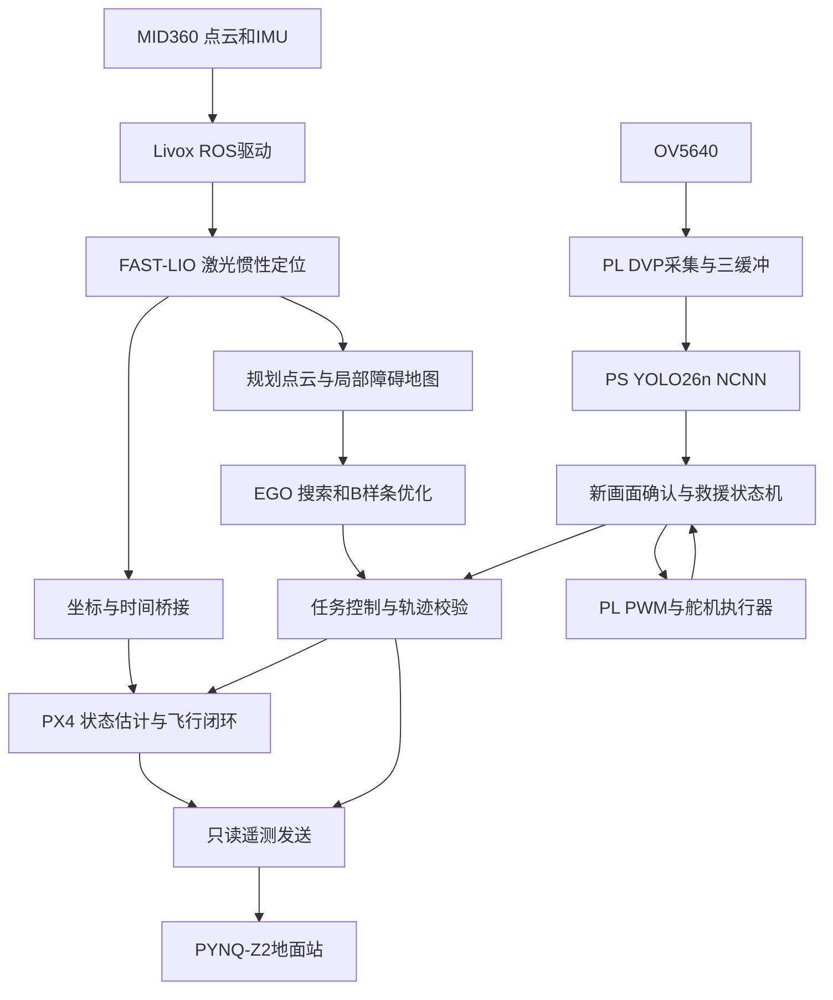
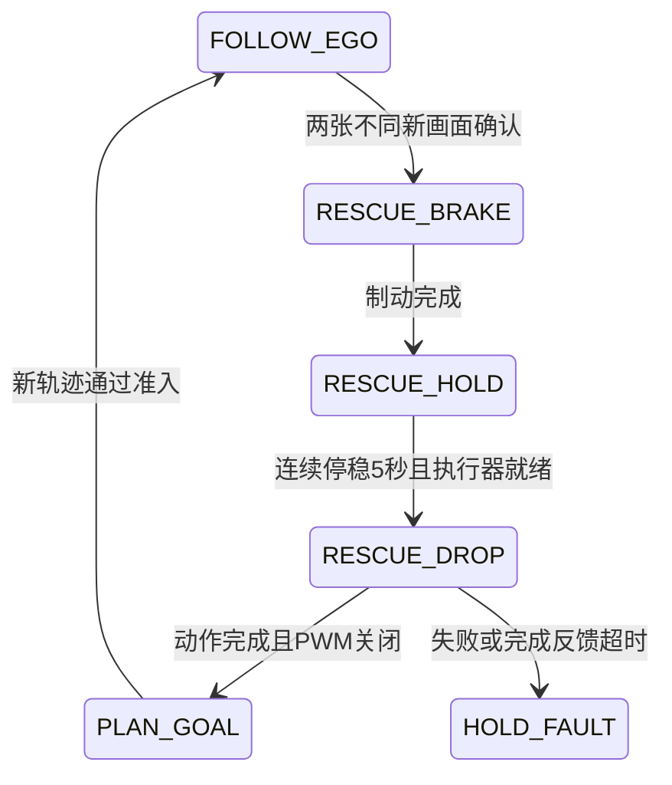

# 基于KR260的救援无人机系统

> 技术报告框架及主要正文。提交时补入团队信息、实物照片、板级资源报告和对应工况的测试图表。

| 项目 | 内容 |
| --- | --- |
| 作品名称 | 基于KR260的救援无人机系统 |
| 参赛方向 | 自主选题，具体组别按报名信息填写 |
| 团队 / 学校 / 指导教师 | 【填写】 |
| 机载平台 | AMD Kria KR260，K26 Zynq UltraScale+ MPSoC |
| 地面平台 | PYNQ-Z2，Zynq-7000 SoC |
| 软件平台 | Ubuntu 22.04、ROS 2 Humble、PX4 |

## 摘要

本作品面向室内复杂环境中的人员搜寻与物资投放任务，以无人机为移动载体，采用 KR260 完成环境感知、定位、局部路径规划和任务管理，结合 PX4 飞控执行底层飞行控制，并通过 PYNQ-Z2 构建独立地面交互与显示终端。

系统以 MID360 点云及 IMU 数据为输入，利用 FAST-LIO 进行激光惯性定位，将定位结果经坐标与时间适配输入飞控，同时向 EGO-Planner 提供规划点云。规划器构建局部障碍地图，通过路径搜索与 B 样条优化生成连续轨迹。任务控制器核对地图、定位、轨迹及控制权状态后输出轨迹设定值。

视觉部分采用 OV5640，经 DVP 接入 PL 完成图像采集与完整帧缓存，再由 PS 上的 YOLO26n NCNN 检测人员目标。救援任务按“新画面确认—制动悬停—限时投放—继续规划”组织。PL 同时提供双通道 PWM 外设，PS 通过 UIO 与原生 MMIO 库控制舵机，构成感知、决策与执行的数据链路。

**关键词：** KR260；PS/PL协同；无人机；激光惯性定位；EGO-Planner；YOLO26；救援投放

## 1. 应用背景与设计目标

厂房、室内通道及模拟灾后空间中，卫星定位条件有限，柱体和通道等障碍物对无人机通行提出要求。人工操纵需要持续观察环境，定位、视觉识别与投放动作也需要统一的任务组织。

本系统以室内模拟救援场景为对象，完成以下功能设计：

1. 基于激光雷达与 IMU 获取连续局部位姿和速度，为飞控提供外部定位。
2. 依据局部地图和任务目标进行 EGO 路径规划与动态重规划。
3. 识别地面人物图像，利用不同新画面进行目标确认。
4. 在满足悬停条件后执行物资投放，再重新规划并接续任务。
5. 通过独立地面站显示地图、规划线、飞行状态与手势交互画面。

【插图1：实际应用场景与作品整体照片】

## 2. 系统总体架构

### 2.1 平台分工

| 平台 | 主要功能 | 主要接口 |
| --- | --- | --- |
| KR260 PS | ROS 2 通信、Livox 驱动、FAST-LIO、EGO-Planner、YOLO26、任务监督与投放调度 | 以太网、串口、UIO、HTTP、ROS 2话题 |
| KR260 PL | OV5640 DVP时序采集、三缓冲帧接口、相机配套外设、PWM舵机控制 | DVP、AXI4-Lite、IIC、UART、PWM |
| PX4 6C Mini | 飞行状态估计、姿态与位置闭环、遥控接管和飞控自身保护 | TELEM2、Micro XRCE-DDS、Offboard接口 |
| PYNQ-Z2 | 地面手势处理、视图切换、地图与仪表显示 | USB摄像头、AXI DMA、HDMI、局域网 |

### 2.2 数据链路

【插图2：系统实物连接图；标明供电、雷达网口、飞控串口、相机与舵机接口】

## 3. 硬件与FPGA设计

### 3.1 机载计算与飞控

KR260 承担机载应用计算，PX4 6C Mini 承担底层飞行闭环。两者通过串口及 Micro XRCE-DDS 交换状态、外部里程计、Offboard 心跳和轨迹设定值。MID360 接入 KR260 的 PS 以太网口，避免与电脑维护链路混用。

飞控固件版本、传感器外参、机体尺寸与实际安装方向应在实验记录中固定，避免混用不同版本的 ROS 消息定义和固件接口。

【填写：实际飞控固件版本、电池、动力配置、供电分配、转接板及机械结构参数】

### 3.2 图像采集与帧缓存

OV5640 采用 DVP 接口。PL 根据像素时钟、行有效和场同步采集 640×480 RGB565 图像；每帧像素数据量为 614,400 字节。设计使用三个帧缓冲区，按 `FREE → WRITING → READY → READING → FREE` 转移所有权。

PS 读取时先认领完整帧；已认领的缓冲区在读取结束前保持不变。新帧可以替换尚未认领的旧 READY 帧，从而限制积压。异常帧与不完整帧不交付上层。PS 使用对齐的32位原生 MMIO 访问，完成复制后释放缓冲区。

相机服务为图像附加采集会话、硬件帧编号和按 PL 帧年龄估算的帧完成时间，使检测结果能够追溯到真实源画面。

### 3.3 PWM舵机外设

PL 实现两路 PWM，PS 通过 AXI4-Lite / UIO 访问配置与状态寄存器。软件按外设地址和 ABI 发现设备，不依赖固定的 UIO 编号。

本项目舵机软件配置允许 500–1700 μs 脉宽、20 ms 周期及0.2–3秒限时动作，一次启用一个通道。初始化保持输出关闭，动作结束后核对请求使能与实际使能状态。任务默认采用通道0、1000 μs、1秒动作，实际机构的开合位置根据机械装配配置。

| 外设 | 地址 | 职责 |
| --- | --- | --- |
| 图像统计外设 | `0xA0000000` | 相机配套统计接口 |
| AXI IIC | `0xA0010000` | 相机寄存器配置 |
| AXI UART | `0xA0020000` | 配套串口接口 |
| SRV1 PWM | `0xA0030000` | 双通道舵机控制 |
| FRM2帧接口 | `0xA1000000` | 完整帧认领、读取与释放 |

【插图3：Vivado Block Design；插表：LUT、FF、BRAM、URAM、DSP、WNS、功耗，按实际综合报告填写】

## 4. 定位与飞控通信

### 4.1 激光惯性定位

Livox 驱动发布点云与 IMU，FAST-LIO 融合两类输入，输出局部位姿、速度及配准点云。定位支路服务于飞控外部定位，规划支路提供经过筛选、裁剪和降采样的环境数据，两条支路分别配置处理参数。

本项目当前定位以激光惯性输入为主，不将任务摄像头作为视觉里程计输入。地图坐标、机体坐标与 PX4 NED 坐标之间通过外参和姿态关系适配。

### 4.2 坐标和时间一致性

规划地图使用 `camera_init` 坐标系；桥接与控制节点将其转换为 PX4 使用的 NED 表达。坐标关系可概括为：

\[
\mathbf p_{NED}=\mathbf R\mathbf p_{map}+\mathbf t
\]

其中旋转与平移由配对观测确定，在任务准备和解锁流程中固定参考关系。目标、轨迹、地图和状态消息需要属于相同任务实例。

系统区分源采样时间、节点接收时间和日志接收时间。消息接收不代表重新采样；桥接不通过刷新旧数据时间戳掩盖过期。性能分析需要对齐同一时间段的上游输出、桥接发布、控制器接收与录包记录。

## 5. EGO-Planner自主避障

### 5.1 局部地图与路径生成

规划支路将点云和当前位姿送入局部地图。地图表达占据、自由和未知区域，结合机体包络与障碍膨胀约束可通行空间。EGO-Planner 根据当前状态与目标生成初始路径，再进行 B 样条优化，兼顾障碍约束与速度、加速度连续性。

B 样条轨迹可表示为：

\[
\mathbf p(t)=\sum_i N_{i,k}(t)\mathbf P_i
\]

其中 \(\mathbf P_i\) 为控制点，\(N_{i,k}\) 为基函数。控制器对轨迹进行采样、坐标转换和准入检查后，向飞控输出设定值。地图或轨迹条件变化时重新规划。

### 5.2 轨迹准入与任务接续

控制器核对规划器来源、地图版本、消息时效、目标身份、运动连续性以及轨迹采样点的碰撞和场地边界条件。目标序列只定义导航目的，实际通行路径由 EGO 结合地图生成。

投放任务中断跟踪后，控制器清除原 B 样条，使用新的目标时间戳重新提交被中断目标。新轨迹与本轮任务、目标身份匹配后再接续，避免直接播放过期轨迹。

### 5.3 启动与运行组织

定位、规划、视觉和控制按依赖关系组织启动；冷初始化与待飞准备分开，待必要状态满足后再提交任务参考。编译使用单任务方式降低峰值资源压力，图像推理采用受限输入尺寸和线程数。

【插图4：地图占据、单障碍绕行及多障碍规划曲线；图注分别说明仿真或实测工况】

## 6. 视觉识别与救援投放

### 6.1 YOLO26人员检测

YOLO26n 使用项目保存的同一权重，通过 NCNN FP32 在 KR260 PS CPU 上推理。任务入口采用320输入、单推理线程、person类置信度阈值0.25；相机 HTTP 预览上限3 FPS。包内另外保留384、480、640输入模型供独立配置。

方向搜索在后续新画面中切换方向，框坐标还原到原始图像后去重。图像服务与推理服务分离，ROS 仅传检测元数据，不将图像复制到救援控制话题中。

### 6.2 救援状态机

确认逻辑保留相机与推理会话、结果编号、帧编号及源时间，重复结果不累积为第二帧。停稳条件包括位置误差、速度和航向约束。一次任务至多发起一次救援投放，避免同一目标持续触发。

执行器校验同一任务及动作编号、控制状态和授权，动作前持久记录请求身份，重启后不重放已认领的动作。完成反馈表示限时命令结束且 PWM 已关闭，机械物资脱落应由现场试验观察或附加传感器核验。

【插图5：人物检测、悬停投放及机构照片；填写实际投放成功次数与试验条件】

## 7. PYNQ-Z2地面站

地面站将摄像头、手势识别、地图和仪表组织为多个显示视图。USB 摄像头输入图像，PL 执行肤色分割、形态学处理和降采样，PS 完成几何分类和多帧投票，通过共享帧接口供显示端读取。

显示链路采用 AXI VDMA 与 RGB2DVI 输出 HDMI。相机、地图与仪表共享显示通道；硬件扫描刷新率与软件画面更新率分别统计。

机载端提供只读遥测与规划线发送接口。地面站中的离线演示地图、轨迹和参数模型，应与实时接入数据在展示说明中区分；显示用轨迹不向飞控发送控制命令。

【插图6：地面站三种视图、手势界面、实际硬件连接】

## 8. 测试方法与结果整理

### 8.1 模块测试与已有记录

下表整理自团队已有报告记录；指标对应原测试工况，不代替其他配置的整链路测量。

| 测试项目 | 工况 | 已有记录 |
| --- | --- | --- |
| 激光惯性定位 | 60秒独立纯定位 | 61/61状态采样为READY，发布频率9.963–9.982 Hz |
| EGO单柱与窄通道 | 板端合成场景 | 分别2359、2052个样点通过轨迹校验；单柱末端差0.0315 m |
| EGO闭环规划 | 空房间、理想位置反馈 | 接受81条轨迹并进入目标0.15 m范围；111次规划耗时P95为3.016 ms、最大5.590 ms |
| 人员识别 | 约90 cm、独立视觉测试、当时标准配置 | 单人、双人、空背景各15次采样，分别输出1、2、0人；约0.8–1.5 FPS |
| 地面站 | 独立综合基线 | 采集30.02 FPS、识别28.06 FPS、画面更新28.05 FPS、帧龄P95为78.30 ms |

历史视觉速率来自当时标准配置，不作为当前320输入任务配置的速度结论。规划耗时与理想反馈数据属于合成场景测试，实机表现应使用相应原始日志另行统计。

### 8.2 本次源码整合软件检查

几何与地图核心、规划准入、阶段计时及新增救援状态机均完成本机纯 C++ 检查；视觉帧身份、执行授权、动作去重、完成接续和 Position 接管完成软件测试。四种 NCNN 输入模型完成加载及空图前向检查。此类检查用于核对实现一致性，不用于代替整机性能测量。

### 8.3 整机展示与补充记录表

| 项目 | 配置 / 记录 |
| --- | --- |
| 实际演示软件版本与提交号 | 【填写】 |
| 视频中采用的导航模式 | 【按视频实际配置填写】 |
| 场地、障碍物与飞行高度 | 【填写，可附示意图；公开版不附私有实飞坐标】 |
| 定位频率、样本年龄P95、最大更新间隔 | 【填写对应日志统计】 |
| CPU平均 / 峰值、内存峰值 | 【填写同一试验时间窗数据】 |
| 规划次数、独立规划耗时P95、最大值 | 【填写，不以重复健康消息代替规划样本】 |
| 识别次数、确认次数、投放次数与成功次数 | 【填写】 |
| 遥控接管与任务停止结果 | 【填写】 |
| 视频、照片和原始记录编号 | 【填写】 |

【插图7：整机实验关键帧与曲线，标注时间轴和测量单位】

## 9. 技术特点与工程实现

1. **PS/PL分工明确。** PL 提供 DVP 时序采集、完整帧所有权和 PWM 输出，PS 处理定位、规划、检测及任务状态，利用可编程逻辑承接确定性的外设接口。
2. **定位、规划和飞控解耦。** 定位与规划使用不同点云支路，通过统一坐标、时间和任务身份连接飞控闭环。
3. **可追溯的视觉确认。** 检测结果关联源帧和源时间，两帧确认不会把同一结果重复计数。
4. **投放与重规划接续。** 投放动作通过独立消息请求和完成反馈闭环组织，恢复任务时重新生成轨迹。
5. **独立FPGA地面站。** PYNQ-Z2 提供手势处理和多视图显示，并预留实时遥测、地图和规划线接入能力。

以上为系统集成与工程实现特点；FAST-LIO、EGO-Planner、YOLO26等第三方算法保留其作者与许可，不作为团队原创算法描述。

## 10. 源码结构与复现索引

| 模块 | 源码位置 |
| --- | --- |
| 雷达与定位 | `src/livox_ros_driver2/`、`src/FAST_LIO/` |
| PX4桥接与消息 | `src/lio_px4_bridge/`、`src/px4_msgs/` |
| EGO规划 | `src/ego_swarm/src/planner/` |
| 任务控制与接口 | `src/kr260_ego_core/`、`src/kr260_ego_pkg/`、`src/kr260_ego_interfaces/` |
| 相机与YOLO26 | `vision/` |
| PWM RTL及驱动 | `hardware/servo/` |
| 地面站 | `ground_station/`、`src/kr260_ground_station/` |
| 软件检查 | `tests/ego/`及各模块测试目录 |
| 救援接口与启动说明 | `docs/RESCUE_FLOW.md` |

ROS 构建、视觉依赖与舵机原生库的命令见根目录及各模块 README。Vivado 集成工程位于 `hardware/servo/vivado/`。源码包不附账号密码、SSH密钥、现场航点、私有日志和本机 Python 虚拟环境。

## 11. 总结与扩展方向

本作品围绕 KR260 构建了定位、EGO局部规划、视觉人员检测和物资投放的软硬件架构，并以 PYNQ-Z2 提供独立交互与显示。设计将持续运动状态估计与高层任务管理放在PS，将相机时序、帧缓存和PWM执行接口放在PL，为后续扩展提供清晰边界。

后续可针对点云筛选、体素化、局部栅格更新或轨迹批量碰撞查询设计PL加速模块，并在相同输入下比较结果一致性、端到端延迟和资源占用。复杂的状态估计、优化迭代与任务策略继续由PS组织。

## 参考资料

- AMD Kria KR260 / K26 官方硬件及软件文档。
- ROS 2 Humble、PX4及Micro XRCE-DDS官方文档。
- FAST-LIO、EGO-Planner原始论文与上游项目，具体许可见本包 `THIRD_PARTY.md`。
- Ultralytics YOLO26与NCNN资料，模型许可见 `vision/LICENSES/`。
- Linux v5.10 OV5640驱动，寄存器表来源及作者信息保留在对应JSON中。

【提交前补齐所引用论文的正式题录、版本号，以及团队实物图片的图号和图注】
